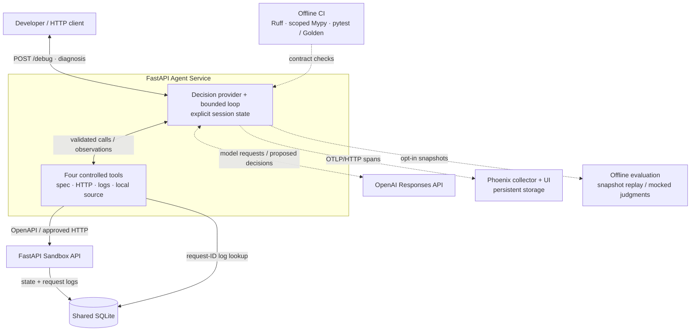
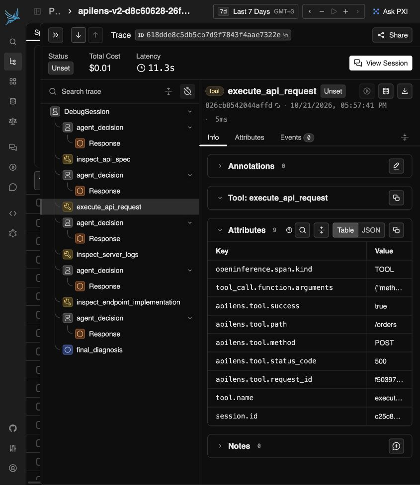
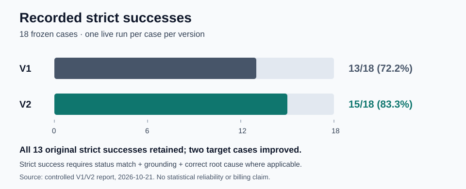

# APILens

**An evidence-driven API debugging agent, with bounded tools and measured results.**

APILens investigates natural-language bug reports against a deliberately faulty
REST API. An LLM chooses what to inspect next; application code validates and
executes each action, records observations, and enforces limits. The result is a
structured diagnosis with evidence, missing information, and a suggested fix.
APILens suggests changes; it does not apply them.

The engineering question is whether an agent can gather the evidence needed to
explain a failure, rather than produce a plausible answer from a prompt alone.
APILens combines real HTTP reproduction, request-correlated logs, restricted
source inspection, explicit session state, and observable decision paths. A frozen
evaluation dataset makes investigation failures and trade-offs inspectable.

In one recorded 18-case comparison, a focused investigation-guidance change
increased strict successes from **13/18 to 15/18**, retaining all 13 prior
successes. This is a limited historical observation, not a reliability guarantee.

[Run locally](#run-locally) · [Recorded results](#what-the-experiments-showed) ·
[Evaluation guide](evaluation/README.md) · [Docker operations](DOCKER.md)

## Architecture

The local stack contains two FastAPI services and Phoenix. OpenAI is contacted
only for live agent or judge requests; startup and offline checks need no key.



Solid arrows show requests, application execution, observations, or storage access.
Dashed arrows show decision-provider exchanges, telemetry, or supporting workflows. The model
does not execute tools directly. Log inspection reads the shared database;
implementation inspection reads packaged, allowlisted source, not arbitrary files
or a remote shell. The evaluation harness also supports separately approved live
collection and judging, outside ordinary CI.

## How an investigation works

1. `POST /debug` validates the issue and creates a fresh `DebugSessionState`.
2. The provider asks the model for one tool call or one final diagnosis.
3. The loop validates the action, checks execution bounds, and dispatches an
   approved tool. Observations, tool history, and discovered request IDs become
   explicit state and subsequent model context.
4. The model chooses whether further evidence is useful. A contract → HTTP
   reproduction → correlated logs → implementation path is possible, but no tool
   or fixed order is mandatory. Static evidence can be sufficient.
5. The service returns a validated `DebugDiagnosis`: `RESOLVED`, `NO_BUG_FOUND`,
   `INCONCLUSIVE`, or application-generated `LIMIT_REACHED`.

| Tool | Evidence it can obtain | Boundary |
| --- | --- | --- |
| `inspect_api_spec` | Documented inputs, responses, schemas | Approved Sandbox endpoints only |
| `execute_api_request` | Real HTTP status/body and `X-Request-ID` | Approved methods and paths; bounded timeout/body size |
| `inspect_server_logs` | Structured events for a request ID | UUID input; shared SQLite |
| `inspect_endpoint_implementation` | Relevant route, model, and database code | Explicit source-section allowlist |

Defaults are **8 decisions, 6 tool executions, 2 identical calls, and a 45-second
session timeout**. Tool names and arguments are validated by application code;
URLs and unsupported endpoints are rejected. The provider permits one correction
for malformed output, and the loop allows one timeout retry within the same
bounds. Approved POST/PATCH calls may change disposable Sandbox data. There is no
source-editing, shell, unrestricted browsing, or production-system tool.

Log lookup validates UUID syntax. Using a request ID observed in the current
session is the intended correlation flow, not an enforced provenance restriction.

Typed contracts validate required fields and status semantics; they cannot prove
that a diagnosis is true. An HTTP 500 is useful evidence, so a successful HTTP
tool execution can report a failing API response. Provider acceptance failures
can produce an `INCONCLUSIVE` fallback rather than a domain diagnosis. See the
[loop](agent_service/agent/loop.py), [contracts](agent_service/agent/schemas.py),
and [dispatch boundary](agent_service/agent/dispatch.py).

## Observing the evidence path

OpenTelemetry and OpenInference export one `DebugSession` trace with
`agent_decision` spans, automatic LLM children, tool spans, and `final_diagnosis`.
Tool executions are siblings of decisions, not model-executed actions. Metadata
includes safe endpoint, request-ID, timing, token-usage, and status information.
Raw issues, model input/output, HTTP bodies, log messages, and source contents are
excluded from trace attributes; LLM error text is sanitized. Investigation input
and tool evidence still go to OpenAI during live reasoning. Opt-in evaluation
snapshots contain private diagnostic content and remain outside Git.



This is a genuine retained V2 `order_missing_inventory_02` investigation from
2026-10-21, displayed in Phoenix from an isolated storage copy. Its five decisions,
four tools, five LLM calls, and final diagnosis match the recorded run. The selected
HTTP tool shows a correlated 500 response; payloads and raw diagnostics are not
shown. It is not the synthetic Docker smoke trace. See
[asset provenance and privacy checks](assets/README.md).

## What the experiments showed

The frozen dataset has **18 cases**: five seeded bug families with three
paraphrases each, two no-bug controls, and one insufficient-input control.
Each evaluation case starts from isolated, reset SQLite fixtures. The six
evaluator families cover tool selection, tool arguments, root cause, grounding,
response quality, and trajectory. Deterministic checks and explicit live judges
have separate roles; agent-only token and latency measurements exclude judging.

**Strict success** requires the expected final status, `GROUNDED` evidence, and
`CORRECT` root cause for bug cases. A correct root cause, a matching status, or a
clear response alone is insufficient. The expected inconclusive control can pass.
Tool efficiency and successful-path convergence are separate measures, not proof
of correctness or global optimality. Judge labels are fallible measurements.

The [V1 baseline](evaluation/reports/v1-baseline-2026-10-18.md) found 13 strict
successes: 12 bug cases and the insufficient-input control. The
[error analysis](evaluation/reports/v1-error-analysis.md) identified two distinct
failure classes: three missing-inventory investigations did not establish the
runtime condition, while two no-bug investigations failed provider acceptance
after correction. The exact rejected response subtype remains unknown.

V2 changed only investigation instructions: consider approved runtime reproduction
when a causal claim depends on unobserved state, use correlated logs when useful,
and clarify that Sandbox POST/PATCH mutations are permitted. Models/settings,
tools, permissions, bounds, fixtures, dataset, and evaluator semantics stayed
fixed. No mandatory sequence or case-specific answer was introduced.



New visualization of the recorded results, not a historical interface screenshot.
Source: [controlled V1/V2 report](evaluation/reports/v1-v2-experiment-2026-10-21.md).

| Recorded measure | V1 | V2 |
| --- | ---: | ---: |
| Strict successes | 13/18 (72.2%) | 15/18 (83.3%) |
| Expected final status matches | 14/18 | 16/18 |
| Correct root cause / scored bug cases | 13/15 | 15/15 |
| Fully grounded cases | 17/18 | 17/18 |
| Agent total tokens | 118,812 | 113,122 |
| Mean agent-session latency | 8.614 s | 9.629 s |

All 13 original strict successes were retained. Missing-inventory `_02` and `_03`
became strict successes; `_01` was `CORRECT` but `PARTIALLY_GROUNDED` and still
failed strict success. Two live `NO_BUG_FOUND` acceptance failures remained
unresolved; neither version actually returned that status. The number of fully
grounded cases did not increase. Preserving strict successes does not exclude
every quality or efficiency regression.

Total tokens fell **4.8%**, while average session latency increased **11.8%**.
This is not a measured monetary saving. Both experiments used `gpt-6-sol` with
medium reasoning and `gpt-6.1-sol` judging. There was one run per case, and the
targeted cases are correlated paraphrases of one bug family. Model/judge
variability, hosted-model changes, and timing noise limit causal and statistical
claims. See the report for denominators, preserved labels, provenance, and the
judge's narrower evidence view in `_01`.

## Run locally

Docker Compose is the recommended path. With Docker running:

```bash
cp .env.example .env  # First setup only; preserve an existing .env.
# Set OPENAI_API_KEY in .env only when you want live debugging.
docker compose config --quiet
docker compose up --build
```

Open [Agent docs](http://127.0.0.1:8001/docs),
[Sandbox docs](http://127.0.0.1:8000/docs), and
[Phoenix](http://127.0.0.1:6006). Startup and free smoke checks require no OpenAI
key. **Live `/debug` requests require valid credentials and may incur API costs.**
The Compose runtime was verified on Docker Desktop/Linux arm64; other runtime
architectures have not been executed here.

[DOCKER.md](DOCKER.md) is the operational guide for prerequisites, credentials,
service addresses, free tool/trace smoke checks, tracing configuration, persistent
SQLite/Phoenix volumes, stop/start, and disposable-state reset. It also explains
why container addresses differ from host addresses.

### Without Docker

Use Python 3.11 or newer; the constrained environment and CI are verified with
Python 3.13. The recorded local development interpreter is CPython 3.13.11.

```bash
python -m venv .venv
source .venv/bin/activate
python -m pip install -c constraints-dev.txt -e ".[dev]"
cp .env.example .env  # First setup only.
```

Run these in separate terminals from the repository root, with the same `.env`
and database path:

```bash
uvicorn sandbox_api.main:app --env-file .env --port 8000
uvicorn agent_service.main:app --env-file .env --port 8001
```

For host tracing, start Phoenix first (for example,
`uvx arize-phoenix==20.23.0 serve`) and retain
`PHOENIX_COLLECTOR_ENDPOINT=http://127.0.0.1:6006` in `.env`.
Otherwise set it blank to disable export. Restart the Agent after configuration
changes. Stop conflicting Docker services before using the same host ports.

A **paid live example**, once credentials are configured:

```bash
curl http://127.0.0.1:8001/debug \
  -H 'Content-Type: application/json' \
  -d '{"issue":"POST /orders returns 500 for product 4 with quantity 1"}'
```

### Verify without paid calls

In the activated development environment:

```bash
ruff check .
python -m mypy
PYTHON_DOTENV_DISABLED=1 OPENAI_API_KEY= EVAL_JUDGE_MODEL= PHOENIX_COLLECTOR_ENDPOINT= python -m pytest
git diff --check
docker compose config --quiet
```

GitHub Actions runs Ruff, scoped strict Mypy, and full pytest, including the
Golden subset, on Ubuntu/Python 3.13. Golden tests use scripted decisions and
mocked judgments alongside real local tools to validate deterministic contracts.
They do **not** validate live LLM reasoning quality. See
[CI coverage and merge gates](evaluation/README.md#offline-verification).
Live collection, calibration, and judging are separate, explicitly paid workflows
documented in [evaluation/BASELINE.md](evaluation/BASELINE.md).

## Scope and limitations

APILens is a constrained learning and portfolio project. It investigates only
its controlled Sandbox, whose defects are intentional. It has no production
authentication or deployment design; Compose is a trusted local demonstration.
Session bounds and typed tools limit actions, but do not eliminate incorrect,
inconclusive, or invalid model results. Raw provider output is not retained, so
some historical acceptance failures cannot be diagnosed more precisely.

The historical results are evidence of an observed improvement, not validation
as a general-purpose autonomous debugger or incident-management product. Next
investigation candidates include sanitized provider acceptance diagnostics and
separately approved repeated measurements. No frontend, automatic repair,
production integration, or additional live experiment is included here.
