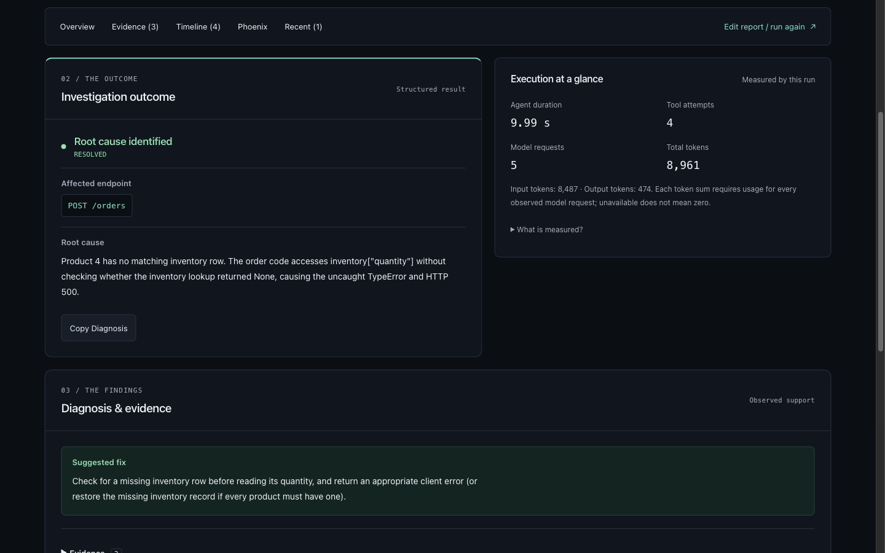
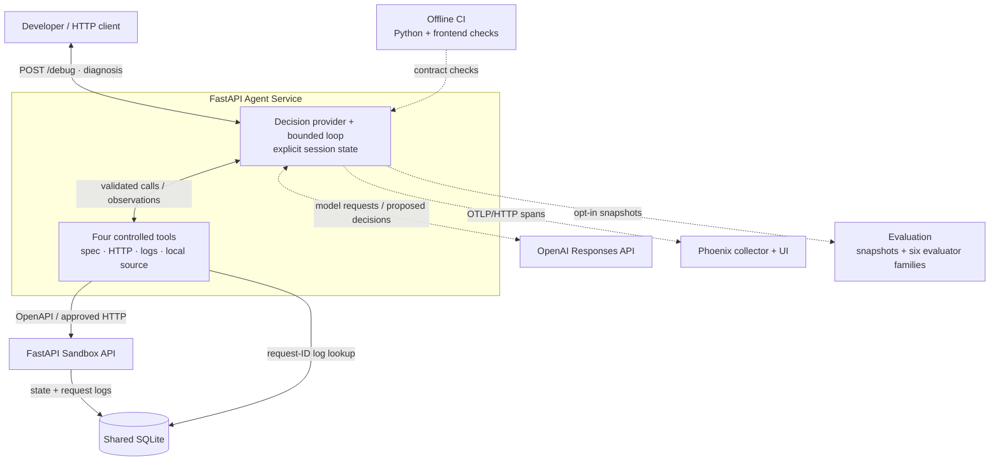
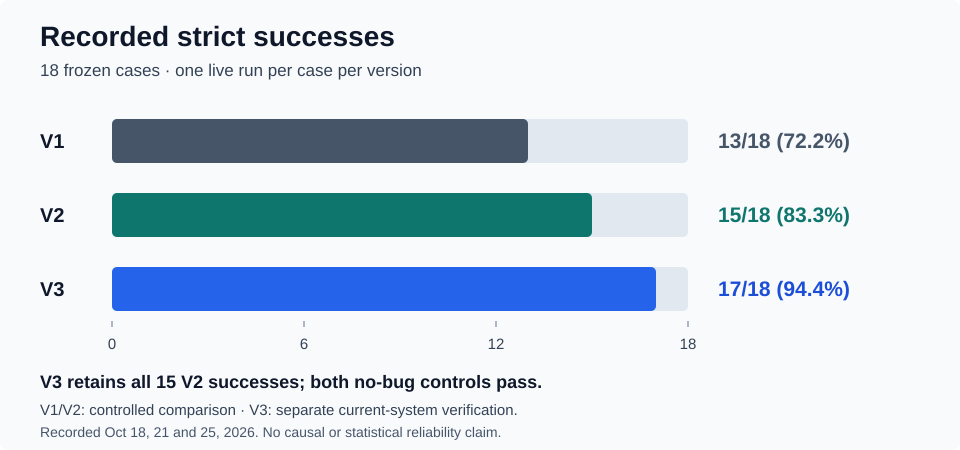

# APILens

**An evidence-driven API debugging agent, with bounded tools and measured results.**

APILens investigates bug reports against a deliberately faulty REST API. An LLM
chooses what to inspect; application code validates and executes each action.
The result is a structured diagnosis with evidence and a suggested fix—not an
applied code change.

[Watch the 71-second demo](assets/demo/apilens-demo.mp4) ·
[Run locally](#run-locally) · [Results](#what-the-experiments-showed) ·
[Technical walkthrough](assets/demo/WALKTHROUGH.md)



Genuine recorded investigation, 24 October 2026: HTTP reproduction, correlated
logs, implementation evidence and its Phoenix trace.
[More screenshots and capture provenance](assets/demo/README.md).

## What it demonstrates

- **Controlled agent execution:** four typed tools, explicit session state and
  application-enforced limits; the model proposes actions rather than executing them.
- **Evidence-based diagnosis:** API contract inspection, real HTTP requests,
  request-correlated logs and allowlisted implementation inspection.
- **Observable investigations:** an authentic tool timeline, measured usage and
  exact-trace Phoenix viewing in the React/TypeScript demo.
- **Evaluation-driven iteration:** a frozen 18-case dataset, six evaluator
  families, a controlled V1/V2 experiment and separate current-system V3 verification.

## Architecture



The React/Vite frontend calls `/demo/debug`, reusing this same loop against a
fresh in-process Sandbox and disposable SQLite database per investigation.
The `/debug` path above uses the configured Sandbox and shared database.

The loop accumulates observations until it returns `RESOLVED`, `NO_BUG_FOUND`,
`INCONCLUSIVE` or `LIMIT_REACHED`. No fixed tool sequence is required. Defaults
are **8 accepted decisions, 6 tool attempts, 2 identical calls and 45 seconds**.
See the [end-to-end code walkthrough](assets/demo/WALKTHROUGH.md#follow-one-report-through-the-code).

## What the experiments showed

The frozen dataset contains 15 bug reports, two no-bug controls and one
insufficient-input control. **Strict success** requires the expected status,
fully grounded evidence and a correct root cause where applicable.



**Purpose of each run**

- **V1 — Oct 18:** establish the initial baseline.
- **V2 — Oct 21:** test a focused investigation-guidance change under controlled conditions.
- **V3 — Oct 25:** verify the current system after later changes, including the diagnosis-schema clarification.

V2 retained all 13 V1 successes. V3 retained all 15 V2 successes and added both
no-bug controls. V3 matched the expected status in 18/18 cases, but one correct
missing-inventory diagnosis remained partially grounded under the judge's
narrower evidence view, so strict success is **17/18**.

These are single-run observations, not reliability guarantees. V3 is not a
third controlled arm of V1/V2: source changes, model/time drift and judge
variability prevent attributing its difference solely to the schema clarification.
Historical reports remain unchanged.

[Controlled V1/V2 results](evaluation/reports/v1-v2-experiment-2026-10-21.md) ·
[V3 results, usage and limitations](evaluation/reports/v3-verification-2026-10-25.md) ·
[Evaluation methodology](evaluation/README.md)

## Run locally

Requires Docker Compose v2 and Node.js 22.12+ on the Node 22 line
(`frontend/.nvmrc`). From the repository root:

```bash
cp .env.example .env  # First setup only; preserve an existing .env.
# Set OPENAI_API_KEY in the private backend .env for live investigations.
docker compose up --build -d --wait
```

In a separate terminal:

```bash
cd frontend
npm ci
npm run dev
```

Open [APILens](http://127.0.0.1:5173). The
[Agent API docs](http://127.0.0.1:8001/docs),
[Sandbox API docs](http://127.0.0.1:8000/docs) and
[Phoenix](http://127.0.0.1:6006) are available separately.

Startup requires no OpenAI key. **Live investigations require backend credentials
and may incur API costs.** Never put a key in frontend files or `VITE_*` variables.
For troubleshooting, storage and shutdown, see [DOCKER.md](DOCKER.md).
[Host Python setup without Docker](agent_service/README.md#run-without-docker)
is also available.

### Demo frontend

Choose Missing inventory, Wrong status, Incorrect total or Response schema—or
enter a custom report. Acknowledge the possible cost and click **Start
investigation**. Selecting a sample makes no request; editing it switches to
free-form fixtures. Results show the outcome, evidence, metrics and chronological
tool activity. A successful HTTP probe can observe an HTTP 500 response.

**Explore Full Trace** embeds the exact Phoenix trace at desktop sizes of at
least 1280 × 720; smaller screens use **Open in Phoenix**. Trace export is
asynchronous: if a trace is unavailable, reopen the same link later rather than
rerunning the investigation. **Copy Diagnosis** copies the structured result.

**Recent investigations** retains five completed results in this browser's
`localStorage`, without encryption or expiry. Records are scoped to the frontend
origin, including hostname and port; use **Clear history** to delete them.
Reopening a result makes no request and preserves your draft. Drafts and cost
consent are not persisted. If storage is unavailable, results remain usable in
memory. There is no backend history service.

### Local demo API

| Endpoint | Execution and response |
| --- | --- |
| `POST /debug` | Configured Sandbox; returns `DebugDiagnosis`. |
| `POST /demo/debug` | Fresh isolated Sandbox; returns `diagnosis`, sanitized `steps`, optional `trace_id` and measured `metrics`. |

Both accept an issue of up to 4,000 characters. The demo additionally accepts
one of the four scenario IDs. They share the same agent, tools and limits;
scenario selection prepares fixtures and never forces a diagnosis.
See the [request/response contract, scenarios and metric definitions](agent_service/README.md#local-demo-api).

### Verify without paid calls

With the [Python development environment](agent_service/README.md#run-without-docker)
installed, run from the repository root:

```bash
ruff check .
python -m mypy
PYTHON_DOTENV_DISABLED=1 OPENAI_API_KEY= EVAL_JUDGE_MODEL= PHOENIX_COLLECTOR_ENDPOINT= python -m pytest
git diff --check
cd frontend
npm ci
npm run typecheck
npm test
npm run build
```

The GitHub Actions `checks` job runs these Python and frontend checks. Golden
regressions use scripted decisions and real local tools; automated tests make
no paid requests and do not measure live model quality.

## Scope and limitations

APILens is a trusted local demo for its intentionally buggy Sandbox,
not arbitrary production APIs. It has no public deployment, authentication,
arbitrary code execution or automatic code changes. Models can still return
incorrect, unsupported, inconclusive or invalid answers.

Phoenix traces exclude raw reports, model I/O, HTTP bodies, logs and source
content; live reasoning still sends the report and tool evidence to OpenAI.
Private evaluation snapshots stay outside Git. Browser-local history stores
submitted reports and structured results, so it should contain only demo data.

For deeper review: [implementation and interview guide](assets/demo/WALKTHROUGH.md),
[live browser verification](assets/demo/VERIFICATION.md), and
[V3 protocol and provenance](evaluation/V3.md).
